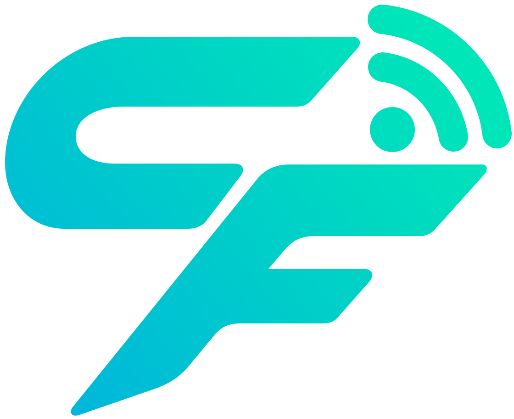
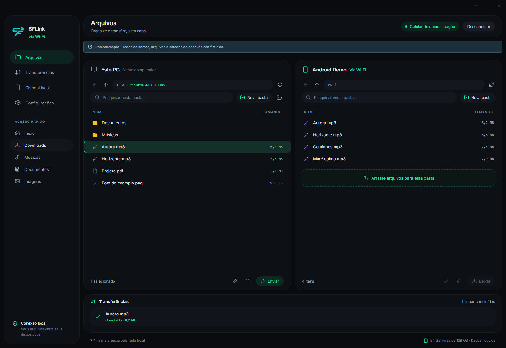
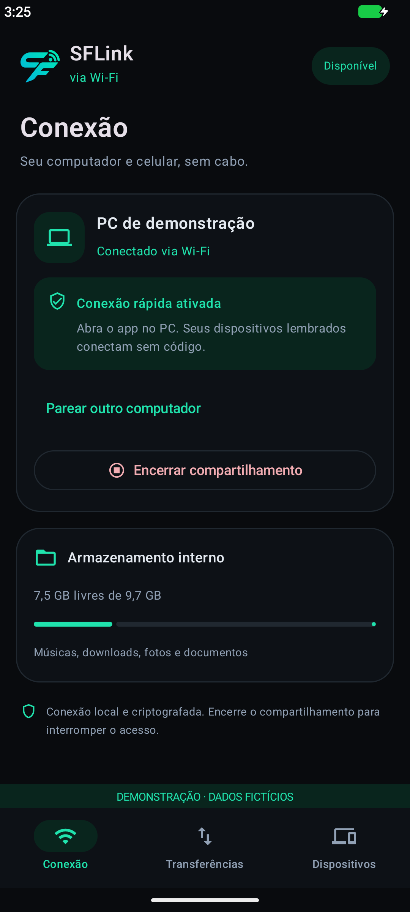

# SFLink

Gerenciador de arquivos entre Windows e Android pela rede Wi-Fi. Explore as pastas do computador e do celular em uma única janela e envie arquivos arrastando para o painel do Android.

- Desktop em Tauri 2, Svelte e Rust; Android nativo em Kotlin/Compose.
- Envio e download em streaming, fila, progresso e cancelamento.
- Navegação, busca, criação de pastas, renomeação e exclusão. Arquivos existentes não são substituídos automaticamente.
- Movimentação de arquivos dentro do Android pelo menu **Mover para…** no painel do celular.
- Primeiro pareamento por IP e código, com autorização e conferência no celular.
- “Lembrar dispositivo” autoriza reconexão sem repetir o código. Revogação disponível no Android.
- Atualizador pelo GitHub Releases, com conferência de tamanho/SHA-256 e confirmação de instalação.

Windows e Android: **0.9.0**. [Baixe o instalador e o APK no GitHub](https://github.com/NskBR/SFLink-APP/releases/tag/v0.9.0). Os aparelhos precisam estar na mesma rede local; isolamento de clientes/broadcast bloqueado pode impedir descoberta ou conexão. Não há acesso às pastas privadas de outros apps Android.

## Capturas de demonstração

As capturas usam nomes, arquivos e conexão fictícios, sem credenciais ou arquivos do usuário. A tela Android foi renderizada no emulador; sua capacidade de armazenamento é a do ambiente de demonstração. As capturas mostram a interface, não uma transferência real.

## Executar e compilar

Windows: instale Node.js, Rust e as ferramentas de compilação do Tauri para Windows. Em `desktop/`, execute `npm ci` e `npm run desktop`. Para gerar executável/instalador: `npm run desktop:build`.

Android: abra `android/` no Android Studio, configure o SDK localmente e sincronize o Gradle. Requer Android 11 ou superior. O usuário precisa autorizar acesso aos arquivos no celular. Para um APK de teste: `gradlew.bat :app:assemblePreview`. Preview usa assinatura de desenvolvimento.

Para produção e atualização Android, configure uma chave privada estável fora do Git. Consulte o [guia de atualização e assinatura](desktop/docs/updates.md). Os binários ficam nos assets da release; nenhum material de assinatura integra o repositório-fonte. Se você usa um APK preview anterior, leia a orientação de migração na release: a assinatura de produção é diferente e exige uma primeira reinstalação/novo pareamento.

## Testes e documentação

- Desktop: `npm run build` e `cargo test --lib` em `desktop/src-tauri/`.
- Android: `gradlew.bat :app:testDebugUnitTest :app:lintPreview`.
- Integração Android: `RememberedConnectionTest`, com emulador/dispositivo de teste. Os testes Rust que exigem pareamento manual são ignorados por padrão.
- [Contrato PC ↔ Android](desktop/docs/android-api.md).
- [Modelo de segurança e revisão dos arquivos](SECURITY.md).
- [Validação desta versão](docs/validation.md).

Para reproduzir a captura desktop, execute o Vite em `desktop/` e abra `/docs-preview.html`; essa entrada usa componentes reais com dados fixos e não integra o build principal. A captura Android é gerada pelo teste `DemoScreenshotTest` em `android/app/src/androidTest/`; a fixture não abre servidor nem grava autorização real.

## Builds de distribuição

Os builds são locais, sem GitHub Actions. O script `tools/build-release.ps1` usa as variáveis de assinatura documentadas e gera os arquivos em `artifacts/` (ignorado pelo Git), incluindo `SHA256SUMS.txt`. A publicação dos assets é uma etapa separada.

## Atalhos e abertura de arquivos

Clique em um painel para ativá-lo. Ctrl+F foca a pesquisa desse painel; Ctrl+A seleciona os resultados visíveis; Delete/Ctrl+Delete abre a confirmação de exclusão; F2 renomeia; F5/Ctrl+R atualiza a pasta; Ctrl+Shift+N cria pasta; Backspace sobe um nível. Em campos de texto, os atalhos de edição continuam funcionando. Shift+clique seleciona um intervalo e Ctrl+clique alterna a seleção.

Dois cliques em arquivo do celular baixa para a pasta aberta no PC e abre fotos e músicas no visualizador interno após concluir; outros tipos continuam abrindo no Windows. Arquivos existentes são preservados, usando um novo nome quando necessário. Não há cache separado. As miniaturas JPG/PNG/WebP são carregadas quando aparecem na lista, ficam apenas em memória e têm limites de tamanho/decodificação. Imagens grandes ou inválidas mantêm o ícone. A fila e as linhas dos arquivos mostram Enviando/Baixando e progresso.

## Visualizador, navegação e personalização (0.5.0)

Fotos abrem em um modal. Músicas abrem no player interno, com capa incorporada (quando presente), reproduzir/pausar, posição, duração e volume. A compatibilidade de áudio depende dos codecs do Windows/WebView2; formatos não reproduzíveis exibem uma mensagem. Arquivos do celular ainda são baixados para a pasta do PC, com progresso, sem cache de mídia separado. No menu de contexto do arquivo local, Abrir no Windows continua disponível.

Os botões laterais do mouse e Alt+Esquerda/Direita navegam pelo histórico do painel. O menu com botão direito oferece abrir, enviar/baixar, renomear, excluir com confirmação, criar pasta, selecionar tudo e atualizar. Configurações organiza Geral, Personalização, Atualizações e Sobre. Temas Esmeralda, Oceano, Ametista e Papel ficam salvos neste PC.

Miniaturas de capa são lidas das tags do arquivo (MP3, M4A, FLAC, OGG e outros formatos reconhecidos), com limites de leitura e decodificação. Músicas sem capa incorporada ou arquivos acima do limite mantêm o ícone; não é feita busca de capa na internet. O visualizador acessa somente arquivos explicitamente abertos, através do protocolo de assets do Tauri, sem permissão global a diretórios. As permissões desses arquivos duram até o app fechar.

A partir da 0.5.0, Baixar e atualizar verifica o instalador, abre um splash, fecha o app, executa o NSIS silenciosamente e reabre o SFLink. A fila deve estar parada. Permissões exigidas pelo Windows continuam sob controle do sistema. Se houver falha, o splash informa o erro; a instalação manual da release continua disponível. Atualizar de versões antigas para 0.5.0 ainda usa o fluxo antigo, pois o atualizador executado é o da versão instalada.

## Player e atualizações (0.6.0)

Player grafite inspirado na referência, com título/artista das tags, capa, reprodução/pausa central, duração, posição e volume. Anterior/próxima percorrem as músicas disponíveis na pasta local do PC; aleatório e repetição controlam essa lista. Fotos abrem diretamente sobre a sobreposição escura, sem caixa, com fechamento por Escape ou clique fora.

O botão Atualizar fica na titlebar. A primeira consulta automática é feita 10 segundos após abrir o app e as seguintes a cada 60 segundos (10, 70, 130…). As consultas não baixam nem instalam nada. Só clicar em Atualizar ou Baixar e atualizar inicia o download verificado e depois a instalação/reabertura com splash. Verificar agora em Configurações consulta sem instalar. A fila deve terminar antes da instalação. Enquanto há download/instalação em curso, novas consultas não concorrem com essa operação.

## Player vertical e botão de atualização (0.7.0)

O player passa a seguir o layout vertical: capa grande (até 512 px), nome e autor centralizados, barra de posição, tempos e controles abaixo. O volume fica num botão que abre o ajuste. O tamanho se adapta à altura da janela sem barras de rolagem. Vídeos MP4/WebM/M4V/MOV compatíveis com os codecs do Windows abrem no mesmo player, na área superior; arquivos do celular continuam sendo baixados para a pasta do PC antes de abrir.

A titlebar não exibe mais um botão de consulta permanente. Atualizar aparece somente quando uma versão mais nova for encontrada, ou enquanto o download/instalação solicitado estiver em andamento. O agendamento de 10 segundos e consultas a cada 60 segundos foi mantido, sem download automático. A consulta manual continua disponível em Configurações → Atualizações.

## Downloads já existentes e histórico clicável (0.8.0)

O duplo clique procura uma cópia local já baixada antes de criar outra transferência. As novas cópias são registradas por identidade do celular, caminho remoto, tamanho e data, com verificação de leitura do arquivo local. O registro dura entre sessões e não armazena tokens. Se a cópia for removida, ficar inacessível ou mudar, o app permite baixar novamente sem substituir um arquivo existente. Para downloads de versões antigas ainda não registrados, a migração usa nome e tamanho na pasta aberta do PC; isso é uma heurística, não uma comparação de conteúdo por hash. Cópias conhecidas de outro dispositivo ou versão de arquivo não são adotadas por essa heurística.

A lista de transferências mostra miniaturas e permite abrir os arquivos concluídos. Downloads abrem a cópia local; envios abrem o arquivo de origem no PC. Se uma cópia de download desaparecer, clicar na transferência oferece o mesmo fluxo de baixar novamente, com o celular conectado. O splash de atualização recebeu fundo transparente, cantos externos arredondados e identidade visual SFLink. O novo splash só é utilizado por atualizações iniciadas na 0.8.0 ou posterior.
